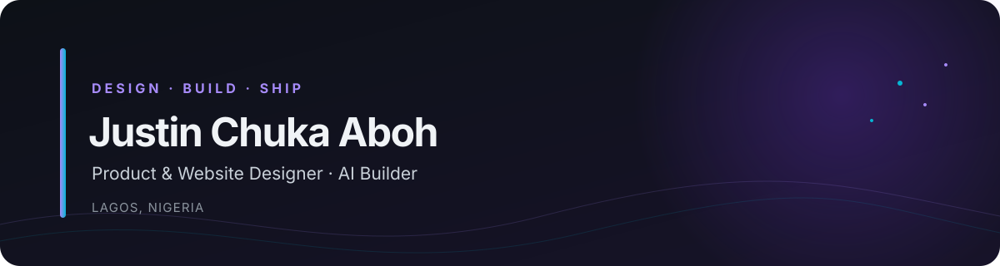
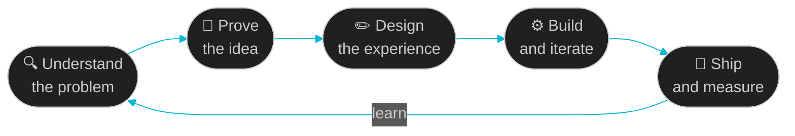

<!--
╔══════════════════════════════════════════════════════════════════╗
║  SETUP                                                           ║
║  1. Create a PUBLIC repo named exactly your GitHub username      ║
║  2. Upload README.md AND the /assets folder (banner + divider)   ║
║  3. Find & replace  Justinaboh  with your GitHub handle       ║
║  4. Fix anything marked 👈 EDIT, then delete these comments      ║
║                                                                  ║
║  OWN BANNER: drop your image in /assets and change the first     ║
║   below, e.g.  ./assets/banner.png                          ║
║                                                                  ║
║  PALETTE: violet 7C3AED · cyan 06B6D4 · bg 0D1117 · text E6EDF3  ║
╚══════════════════════════════════════════════════════════════════╝
-->

<!-- 👈 EDIT: to use your own banner, change this path (PNG, JPG, GIF or SVG) -->

 

  

<!-- 👈 ADD LATER: Behance and portfolio badges

-->

  

[**About**](#-about) · [**Now**](#-currently) · [**Work**](#-selected-work) · [**Stack**](#-stack) · [**Stats**](#-activity) · [**Process**](#-how-i-work) · [**Writing**](#-writing--playbooks) · [**Contact**](#-lets-build)

## 👋 About

Hi, I'm **Justin Chuka Aboh**, an independent **product and website designer** who builds **AI-native** tools, based in **Lagos, Nigeria**.

I design and ship end to end: product interfaces, websites and the AI systems behind them, from the first sketch of a messy problem to a working, polished product people actually want to open. My work sits where **clean, premium design** meets **autonomous systems**: flow simulators, multi-agent business operating systems and interactive visualization tools.

I care about the details people feel but rarely notice, and about making complex things feel calm. If it looks like it belongs on a MacBook, I'm happy.

<table>
<tr>
<td align="center" width="25%"><h3>🎨</h3><b>Product design</b> Minimal, premium, editorial interfaces</td>
<td align="center" width="25%"><h3>🌐</h3><b>Website design</b> Sites that look sharp and convert</td>
<td align="center" width="25%"><h3>🧠</h3><b>AI systems</b> Agents, workflows and orchestration</td>
<td align="center" width="25%"><h3>🚀</h3><b>Ship</b> Idea to launch, no handoff loss</td>
</tr>
</table>

## 🔭 Currently

<table>
<tr>
<td width="50%" valign="top">

**🔨 Building**
- **PromptStudio 3D** — camera and pose to cinematic AI prompts
- **Mockup Studio** — screenshot-to-device mockup generator
- **ContextOS** — work memory for decisions and commitments

</td>
<td width="50%" valign="top">

**🧪 Exploring**
- Agent-native app frameworks
- Multi-tenant SaaS paths for AgentOS
- New ways to make AI tools feel effortless

</td>
</tr>
<tr>
<td width="50%" valign="top">

**🤝 Open to**
- Product and website design projects
- AI tooling and automation for businesses
- Partnerships and co-building

</td>
<td width="50%" valign="top">

**💬 Ask me about**
- Product and website design
- AI-native tools and agents
- Going from idea to shipped product, fast

</td>
</tr>
</table>

## ✨ Selected Work

<!-- 👈 EDIT: replace each # with the real repo or live link (e.g. https://github.com/Justinaboh/repo-name) -->

<table>
<tr>
<td width="33%" valign="top">

### 🤖 AgentOS
An autonomous **multi-agent business operating system**: a CEO orchestrator coordinating five department agents. Self-hostable, built for agency-model delivery with a path to multi-tenant SaaS.

<code>Node.js</code> <code>React</code> <code>SQLite</code> <code>Docker</code>

[Live](#) · [Code](#)

</td>
<td width="33%" valign="top">

### 🧠 ContextOS
**Your work, remembered. Your next move, clearer.** AI memory for independent professionals and small teams: decisions, commitments and source-cited answers.

<code>TypeScript</code> <code>React</code> <code>PostgreSQL</code> <code>AI</code>

[Live](#) · [Code](#)

</td>
<td width="33%" valign="top">

### 🎥 PromptStudio 3D
A studio-grade 3D workspace that turns **camera, lens, light and pose** into cinematic prompts for Midjourney, Flux and Stable Diffusion, plus video prompts.

<code>React</code> <code>Three.js</code> <code>R3F</code> <code>Tailwind</code>

[Live](#) · [Code](#)

</td>
</tr>
<tr>
<td width="33%" valign="top">

### 💻 Mockup Studio
Upload a screenshot, drop it into a laptop or monitor scene, restyle the environment and export in high resolution. Fully client-side, premium and minimal.

<code>React</code> <code>Canvas</code> <code>Three.js</code>

[Live](#) · [Code](#)

</td>
<td width="33%" valign="top">

### 🌊 VizFlow
A FigJam-style **infinite canvas and flow simulation** tool for mapping how things move through a system.

<code>React</code> <code>Vite</code> <code>Tailwind</code> <code>Zustand</code>

[Live](#) · [Code](#)

</td>
<td width="33%" valign="top">

### 📡 LeadRadar
A multi-user app that finds and scores client and job leads automatically, with profession-based onboarding, urgency scoring and Excel/CSV export.

<code>Python</code> <code>HTML/CSS/JS</code>

[Live](#) · [Code](#)

</td>
</tr>
</table>

<b>🗂 More builds (click to expand)</b>

 

| Project | What it is |
|:--|:--|
| **System Mapper** | Browser-based system mapping with canvas graphs, particle flow simulation and natural-language map generation |
| **Wealth Engine Console** | Interactive visualization of a multi-engine wealth-building framework |
| **Veridian Craft** | Prototype for a sustainable handcrafted goods platform with customer, artisan and admin views and material traceability |
| **Claude Websites Workshop** | An 18-slide deck on building websites with Claude, in a deep navy and coral theme |

## 🛠 Stack

 

  

<b>Also:</b> Zustand · PptxGenJS · Anthropic API · Agent-native frameworks · Design tokens and systems

## 📊 Activity

## 🧭 How I Work

| 🎯 **Clarity first** | 🎨 **Craft always** | ⚡ **Prove, then build** | 🔁 **Ship and learn** |
|:--:|:--:|:--:|:--:|
| Solve the right problem before the pretty one | Details are the product | Validate before you invest | Every launch feeds the next |

## 📚 Writing & Playbooks

I write practical playbooks and books on building, pricing and staying relevant, published under **MavericGrowth OS**.

- 📘 **Prove It Before You Build**
- 📗 **Problem Intelligence Playbook**
- 📙 **How to Stay Relevant in the Age of AI**

<!-- 👈 EDIT: add links (Gumroad, Selar, your site) to each title above, or delete this section -->

## 🤝 Let's Build

**Need a product or website designed, or an AI system built?**
Let's talk.

 

  

⭐ If something here inspired you, a star goes a long way.

